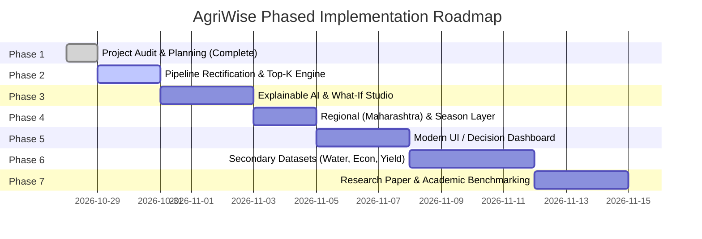

# AgriWise: Phased Implementation Roadmap

**Project Title:** AgriWise Decision Support System  
**Document Version:** 1.0 (Implementation Strategy)  
**Execution Mode:** Phased, Non-Destructive, Research-Oriented  

---

## 1. Roadmap Overview & Phased Progression

The implementation plan is structured into seven distinct, prioritized phases designed to minimize risk, prevent breaking changes, and maintain a continuously demonstrable system throughout development.

---

## 2. Phase Breakdown & Execution Milestones

### Phase 1: Project Audit, Baseline Preservation & Specification (Status: Completed)
- **Objective:** Establish the ground truth of the existing repository, verify datasets and models, uncover hidden bugs, and create architectural blueprints.
- **Key Deliverables Completed:**
  - `PROJECT_AUDIT.md` (Uncovered critical 5.91% live pipeline failure; benchmarked 99.55% true baseline).
  - `PROPOSED_ARCHITECTURE.md` (Modular structure, separation of concerns).
  - `DATASET_REQUIREMENTS.md` (Specifications for future datasets).
  - `RESEARCH_PLAN.md` (Academic RQs, literature review gaps, ablation studies).
  - `IMPLEMENTATION_ROADMAP.md` (This document).
  - Git branch checkpoint created: `agriwise-architecture`.
- **Risk / Complexity:** Low.

---

### Phase 2: Pipeline Rectification & Core Recommendation Hardening
- **Objective:** Fix the fatal scaler bug without altering the legacy files, create a clean `src/ml` package, generate Top-5 candidate predictions with calibrated probabilities, and validate input ranges.
- **Tasks:**
  1. Create `src/ml/preprocessor.py`: Implements a clean, persistent `MinMaxScaler` fitted exclusively on training data and stored in `src/ml/artifacts/scaler.pkl`.
  2. Create `src/ml/predictor.py`: Ingests the 7 features, runs scaling, generates Top-5 candidate crops, computes calibrated suitability percentages, and applies agronomic input bounds ($N, P, K \ge 0$, $\text{pH} \in [3, 10]$, $\text{rainfall} \ge 0$).
  3. Validate against the legacy `model.pkl` to confirm prediction accuracy returns from 5.91% to >99%.
  4. Write automated unit tests in `tests/test_predictor.py` to ensure zero regression.
- **Dependencies:** Phase 1 audit complete.
- **Estimated Complexity:** Low | **CPU Overhead:** Minimal (< 200 ms inference).

---

### Phase 3: Explainable AI (XAI) & Counterfactual What-If Studio
- **Objective:** Transform black-box predictions into transparent, defensible agronomic explanations and interactive simulation.
- **Tasks:**
  1. Implement `src/xai/explainer.py` using `shap.TreeExplainer`.
  2. Compute exact local Shapley attributions for any given input vector.
  3. Generate feature importance waterfall charts showing positive and negative drivers for the recommended crop.
  4. Implement contrastive explanations: *Why was Crop 1 chosen over Crop 2?*
  5. Implement `src/xai/counterfactual.py` for What-If scenario modeling (e.g., *What happens to crop ranking if rainfall decreases by 25% or soil pH increases to 7.5?*).
- **Dependencies:** Phase 2 predictor.
- **Estimated Complexity:** Medium | **CPU Overhead:** ~50–150 ms per explanation on CPU.

---

### Phase 4: Regional (Maharashtra) & Seasonal Decision Layer
- **Objective:** Ground predictions in regional geography and agricultural calendars, initially supporting Maharashtra's agro-climatic zones and districts.
- **Tasks:**
  1. Create `data/reference/maharashtra_calendar.json` documenting sowing windows and crop seasons (Kharif, Rabi, Summer) for target crops.
  2. Implement `src/modules/regional/location_manager.py` allowing users to select District and Season.
  3. Implement seasonal suitability masking in `src/decision_engine/synthesizer.py`:
     - If user selects "Rabi season", warm-season crops like Rice are flagged as unseasonal, elevating cool-season crops like Chickpea or Wheat.
  4. Clearly document the boundary: Regional recommendations are driven by documented agricultural calendars, avoiding fabricated synthetic observations.
- **Dependencies:** Phase 2 predictor.
- **Estimated Complexity:** Low-to-Medium | **CPU Overhead:** Negligible.

---

### Phase 5: Modern Web UI & Academic Decision Dashboard
- **Objective:** Upgrade the single-page legacy UI into an aesthetically stunning, modern, responsive multi-section web application suitable for an MCA major project demonstration.
- **Design Specifications:**
  - Curated agricultural palette (deep emerald `#1b4332`, sage `#40916c`, soft cream `#f8f9fa`, slate dark mode `#1a1f24`).
  - Modern typography (Inter / Outfit from Google Fonts).
  - Micro-animations and responsive CSS grid (no bulky UI frameworks).
  - Interactive What-If simulation sliders with real-time Chart.js visual feedback.
  - Dedicated pages: Dashboard, Crop Recommendation, Explainability Studio, What-If Simulator, Model Evaluation Metrics, Dataset Provenance & Citations, About Project.
- **Dependencies:** Phases 2, 3, and 4.
- **Estimated Complexity:** Medium | **CPU Overhead:** Client-side rendering.

---

### Phase 6: Secondary Dataset Ingestion (Pending User Data Provision)
- **Objective:** Incrementally integrate verified external datasets for Water, Economics, and Historical Yield once provided by the user.
- **Tasks:**
  1. Ingest verified Crop Water Requirements ($ET_c$) table $\rightarrow$ Activate Water Sustainability Index ($I_{\text{water}}$).
  2. Ingest verified Agmarknet Mandi wholesale price trends $\rightarrow$ Activate Market Feasibility module.
  3. Ingest district-wise historical yield records $\rightarrow$ Activate Yield Trend analytics.
  4. Note: Until verified data is supplied, these sections in the UI will display a clean "Data Integration Roadmap" state.
- **Dependencies:** User-provided verified dataset information.
- **Estimated Complexity:** Medium-to-High | **CPU Overhead:** Dependent on dataset size (kept within 16 GB RAM limits).

---

### Phase 7: Model Comparison Benchmark, Evaluation Suite & Research Paper Draft
- **Objective:** Finalize empirical validation, generate publication-ready tables and figures, and compile the academic project report and research paper.
- **Tasks:**
  1. Execute comparative benchmarks across Logistic Regression, GaussianNB, SVM, Decision Tree, Random Forest, and Gradient Boosting.
  2. Record 5-Fold Cross-Validation Accuracy, Precision, Recall, Macro F1, training latency, inference latency, and confusion matrices.
  3. Execute the 4 ablation studies specified in `RESEARCH_PLAN.md`.
  4. Compile `RESEARCH_PAPER_DRAFT.md` with structured sections: Abstract, Introduction, Related Work, Methodology, Results, Ablations, Discussion, and Conclusion.
- **Dependencies:** Phases 2 through 6.
- **Estimated Complexity:** Medium.

---

## 3. Features Explicitly Deferred or Excluded

To ensure strict adherence to project scope and technical integrity:
1. **Plant Disease Detection (Explicitly Excluded):** Leaf image classification, CNNs, and plant pathology modules are excluded from the project scope.
2. **Paid External APIs:** No paid weather or commercial agricultural APIs will be introduced.
3. **GPU-Dependent Deep Learning:** Transformers or heavy neural networks requiring GPU acceleration are excluded. The system runs entirely on standard CPU hardware with 16 GB RAM.
4. **Autonomous Generative LLM Advice:** Unverified generative LLM chat without retrieval grounding is deferred to prevent hallucinated fertilizer dosages or chemical advice.
