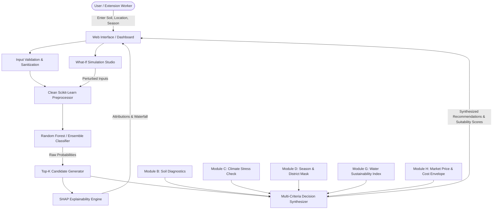

# AgriWise: Proposed System Architecture

**Project Title:** AgriWise: An Explainable, Climate-Aware and Region-Specific AI Decision Support System for Sustainable Crop Selection  
**Document Version:** 1.0 (Architecture Blueprint)  
**Target Environment:** Local CPU-Only (x86_64, Windows, 16 GB RAM), Python 3.10+  

---

## 1. Architectural Philosophy & Design Principles

The transformation of the legacy single-script crop classifier into the **AgriWise Decision Support System** follows five foundational engineering principles:

1. **Non-Destructive Evolution:**  
   The legacy dataset, model, and application logic remain accessible as a verified baseline (`baseline/`) for academic benchmark comparisons.
2. **Separation of Concerns:**  
   Distinct boundaries separate the Machine Learning pipeline, Data Integration layer, Agronomic Decision rules, Explainability engines, and Presentation interfaces.
3. **Calibrated Probabilistic Scoring vs. Agricultural Suitability:**  
   Classifier class probabilities ($P(\text{crop} \mid X)$) reflect statistical pattern matching within the training envelope. Real-world **Agricultural Suitability** is synthesized via a multi-criteria decision layer combining:
   - ML Agro-Climatic Suitability Score ($S_{\text{agro}}$)
   - Seasonal Viability Mask ($M_{\text{season}}$)
   - Water Sustainability Index ($I_{\text{water}}$)
   - Regional Economic Feasibility Score ($S_{\text{econ}}$)
4. **Explainability by Design:**  
   Black-box predictions are supplemented with local feature attributions using TreeSHAP, contextualized with agronomic parameter ranges.
5. **No Data Fabrication Policy:**  
   Modules requiring external datasets (Mandi prices, district-wise soil maps, IMD rainfall) remain modular and gracefully display "Data Integration Pending" until verified data sources are approved and connected.

---

## 2. Proposed Directory Structure

```
s:\MCA 2 Mini project\crop\
├── .git\
├── .gitignore
├── README.md
├── requirements.txt                      # Formal dependencies (locked for CPU environments)
├── PROJECT_AUDIT.md                      # Audit of legacy system & baseline results
├── PROPOSED_ARCHITECTURE.md             # This document
├── DATASET_REQUIREMENTS.md               # Integration specs for secondary datasets
├── RESEARCH_PLAN.md                      # Academic paper methodology & research gaps
├── IMPLEMENTATION_ROADMAP.md             # Phased execution plan
│
├── legacy/                               # Preserved original project for baseline comparison
│   ├── app.py
│   ├── model.pkl
│   ├── minmaxscaler.pkl
│   ├── standscaler.pkl
│   ├── Crop_recommendation.csv
│   └── templates/
│       └── index.html
│
├── data/                                 # Data management directory
│   ├── raw/                              # Pristine, unmodified source datasets
│   │   └── Crop_recommendation.csv       # Benchmark 2,200 sample dataset
│   ├── processed/                        # Cleaned, validated, and normalized data
│   │   ├── crop_features_train.csv
│   │   └── crop_features_test.csv
│   ├── reference/                        # Agronomic domain knowledge tables
│   │   ├── crop_agronomic_profiles.json  # Optimal pH, temp, water envelope
│   │   └── maharashtra_calendar.json     # Season calendars (Kharif, Rabi, Summer)
│   └── schemas/                          # Data validation schemas (Pydantic / dataclasses)
│
├── src/                                  # Core business and ML logic
│   ├── __init__.py
│   ├── core/                             # Foundational constants, config, and logging
│   │   ├── config.py
│   │   └── exceptions.py
│   ├── ml/                               # Machine Learning Pipeline
│   │   ├── __init__.py
│   │   ├── preprocessor.py               # Robust scaler & leakage-free transformer
│   │   ├── train.py                      # Multi-model training and evaluation harness
│   │   ├── evaluate.py                   # Stratified CV, F1, confusion matrices
│   │   ├── predictor.py                  # Top-K candidate generator & probability calibrator
│   │   └── artifacts/                    # Retrained production model artifacts
│   │       ├── best_model.pkl
│   │       ├── scaler.pkl
│   │       └── label_encoder.json
│   ├── xai/                              # Explainable AI & Counterfactuals
│   │   ├── __init__.py
│   │   ├── explainer.py                  # TreeSHAP explainer & waterfall plots
│   │   └── counterfactual.py             # What-if perturbation & delta analyzer
│   ├── modules/                          # Domain-Specific Integration Modules
│   │   ├── soil/                         # Module B: Soil profile assessment
│   │   │   ├── __init__.py
│   │   │   └── soil_analyzer.py
│   │   ├── weather/                      # Module C: Agro-climatic weather analysis
│   │   │   ├── __init__.py
│   │   │   └── weather_service.py
│   │   ├── regional/                     # Module D: District & season matching
│   │   │   ├── __init__.py
│   │   │   └── location_manager.py
│   │   ├── water/                        # Module G: Water balance & sustainability
│   │   │   ├── __init__.py
│   │   │   └── water_budget.py
│   │   ├── economics/                    # Module H: Mandi price & gross margin
│   │   │   ├── __init__.py
│   │   │   └── market_analyzer.py
│   │   └── yield/                        # Module I: Historical district yield trends
│   │       ├── __init__.py
│   │       └── yield_evaluator.py
│   └── decision_engine/                  # Multi-Criteria Recommendation Synthesizer
│       ├── __init__.py
│       └── synthesizer.py                # Combines ML + Season + Water + Economy
│
├── web/                                  # Web Application Layer (Modern, modular UI)
│   ├── __init__.py
│   ├── app.py                            # Flask application factory
│   ├── routes/
│   │   ├── main_routes.py                # Home, Dashboard, About
│   │   ├── recommend_routes.py           # Core recommendation, Top-K, Explainability
│   │   ├── simulation_routes.py          # What-if / Counterfactual simulator
│   │   └── analytics_routes.py           # Regional, Weather, Soil, Market analytics
│   ├── static/                           # Static assets
│   │   ├── css/
│   │   │   ├── tokens.css                # CSS variables, modern dark/light agricultural theme
│   │   │   └── main.css                  # Modern UI, glassmorphism, micro-animations
│   │   ├── js/
│   │   │   ├── charts.js                 # Chart.js visualizations
│   │   │   └── whatif.js                 # Interactive slider & delta calculations
│   │   └── img/                          # Vector icons and crop assets
│   └── templates/
│       ├── base.html                     # Unified responsive master layout
│       ├── dashboard.html                # Central agricultural decision dashboard
│       ├── recommend.html                # Multi-parameter recommendation & Top-5 ranking
│       ├── explain.html                  # SHAP feature attribution & waterfall charts
│       ├── what_if.html                  # Interactive counterfactual simulation studio
│       ├── soil_weather.html             # Agro-climatic analysis
│       ├── sustainability.html           # Water & ecological footprint
│       ├── economics.html                # Market trends & gross margin estimates
│       ├── model_evaluation.html         # Live reproducible research metrics & confusion matrix
│       ├── provenance.html               # Dataset information, data provenance, citations
│       └── about.html                    # Academic project scope, methodology, team
│
└── tests/                                # Automated unit & regression tests
    ├── test_preprocessor.py
    ├── test_predictor.py
    ├── test_decision_engine.py
    └── test_routes.py
```

---

## 3. Detailed Module Specifications

### Module A: Core Crop Recommendation Engine
- **Responsibility:** Ingests user input parameters ($N, P, K, \text{temp}, \text{humidity}, \text{pH}, \text{rainfall}$), applies the validated scaling pipeline, and queries the ensemble classifier.
- **Key Enhancements:**
  - **Top-5 Candidate Ranking:** Instead of a single label, outputs the top 3–5 candidate crops ranked by class probability.
  - **Probability Calibration:** Clarifies that statistical probability $P(\text{crop} \mid X)$ indicates proximity to ideal envelope data, not guaranteed field success.
  - **Input Range Sanity Checks:** Validates agronomic bounds (e.g., pH between $3.0$ and $10.0$, rainfall $\ge 0$).

### Module B: Soil Analysis Layer
- **Responsibility:** Assesses macronutrient balance (N:P:K ratios) and soil reaction (pH).
- **Future Integration Hooks:** Pre-configured data structures for Organic Carbon (OC), Electrical Conductivity (EC), and soil texture classes (clay, loam, sandy loam).
- **Agronomic Feedback:** Generates diagnostic flags (e.g., "Soil is acidic ($pH < 5.5$), which may inhibit Phosphorus uptake").

### Module C: Weather & Climate Analysis Layer
- **Responsibility:** Isolates temperature, humidity, and rainfall inputs. Distinguishes long-term historical norms from seasonal forecasts.
- **Risk Indicators:** Flags agro-climatic stress conditions (drought risk, excessive rainfall during flowering, thermal stress).

### Module D: Location & Season Awareness Layer
- **Responsibility:** Regional contextualization initially focused on Maharashtra’s agro-climatic zones (e.g., Western Maharashtra, Marathwada, Vidarbha, Konkan).
- **Seasonal Alignment:** Filters or flags candidate crops by season:
  - **Kharif:** June – October (monsoon dependent: Rice, Cotton, Soybean, Maize).
  - **Rabi:** October – March (post-monsoon: Chickpea, Wheat, Mustard).
  - **Summer (Zaid):** March – June (irrigated: Groundnut, Vegetables, Pulses).

### Module E: Explainable AI (XAI) Layer
- **Responsibility:** Generates transparent, local and global explanations using TreeSHAP (`shap.TreeExplainer`).
- **Outputs:**
  - Feature attribution waterfall showing which environmental factors drove the top recommendation.
  - Pairwise contrastive explanation: *Why was Crop A ranked higher than Crop B?* (e.g., "Higher rainfall (+80 mm) penalized Maize and favored Rice").
  - Clear documentation of model explanation boundaries.

### Module F: What-If & Counterfactual Analysis Studio
- **Responsibility:** Allows agricultural extension workers and farmers to explore simulated environmental scenarios.
- **Functionality:**
  - Interactive sliders for adjusting soil nutrients or simulated rainfall deficits.
  - Real-time comparison: Original vs. Counterfactual candidate ranking.
  - **Agronomic Guardrail:** Explicitly notes that model simulations are exploratory sensitivity analyses and do not constitute physical soil-amendment guarantees.

### Module G: Water Availability & Sustainability Layer
- **Responsibility:** Matches crop physiological water requirements (mm/season) against available water resources (rainfall + irrigation availability: Rainfed, Canal, Borewell, Drip).
- **Output:** Categorizes recommendations into Low, Medium, or High water-intensity crops, promoting sustainable groundwater conservation.

### Module H: Economic & Market Analysis Layer
- **Responsibility:** Connects crop candidates to economic indicators when verified mandi data is integrated.
- **Metrics:** Modal market price trends (₹/quintal), estimated gross revenue, and indicative operational cultivation costs.
- **Integrity Rule:** Revenue is never equated to profit without transparent documentation of average district yields and cultivation expenditure.

### Module I: Crop Yield Analysis Layer
- **Responsibility:** Retains historical yield analysis as an independent analytical and modeling task.
- **Integrity Rule:** Treats classification (crop suitability) and regression (yield in tonnes/hectare) as distinct problems with separate targets and validation protocols.

### Module J: Agricultural AI Assistant (Future Optional Layer)
- **Responsibility:** Provides natural language summaries of model findings grounded exclusively in validated agricultural knowledge bases.
- **Safety Rule:** No chemical dosages, off-label pesticide recommendations, or hallucinations.

---

## 4. End-to-End Data Flow



---

## 5. Technology Selection Rationale

- **Backend (Flask):** The existing project utilizes Flask. Keeping Flask avoids unnecessary framework thrashing, preserves existing deployment paths, and integrates seamlessly with scientific Python libraries (`scikit-learn`, `shap`, `pandas`, `numpy`).
- **Frontend (Modular CSS & Chart.js):** Custom CSS design tokens with responsive layout ensures an aesthetically superior, academic-grade dashboard without heavy Node/React build overheads on a 16 GB CPU machine.
- **Explainability (TreeSHAP):** TreeSHAP computes exact Shapley values in polynomial time for tree-based models (`RandomForest`, `DecisionTree`), ensuring millisecond-level responsiveness on CPU.
