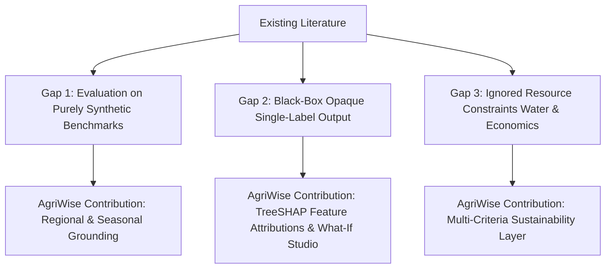

# AgriWise: Research Planning & Methodology Document

**Proposed Paper Title:**  
*AgriWise: An Explainable, Climate-Aware and Region-Specific AI Decision Support System for Sustainable Crop Selection*

**Author:** Shravani Pawar  
**Program:** Master of Computer Applications (MCA) — Major Project  
**Target Venue:** Peer-Reviewed Agriculture AI / Applied Computing Conference or Journal (e.g., IEEE Access, Springer CCIS, or Elsevier Computers and Electronics in Agriculture)  
**Status:** Pre-Experimental Research Formulation  

---

## 1. Problem Statement

Conventional machine learning crop recommendation systems predominantly treat agricultural decision-making as an isolated 1-of-$K$ multi-class classification problem trained on idealized, synthetic soil-nutrient and meteorological envelopes. While these benchmark models report impressive predictive accuracy exceeding 99%, their real-world utility for practicing farmers and agricultural extension officers is critically constrained by three foundational gaps:

1. **Spatial and Seasonal Blindness:** A crop predicted purely from nominal $N, P, K$ and mean temperature may be agronomically unviable in a specific district due to seasonal sowing windows, local frost/monsoon dynamics, or regional soil depth.
2. **The "Black-Box" Adoption Barrier:** Farmers are reluctant to adopt opaque model outputs without understanding *why* a particular crop is recommended or *which* limiting factor (e.g., soil acidity, potassium deficiency, or inadequate rainfall) penalizes alternative crops.
3. **Absence of Sustainability and Economic Trade-offs:** Maximizing agronomic fit without accounting for crop water requirements or market price volatility can encourage the cultivation of water-intensive cash crops in drought-prone regions, accelerating groundwater depletion and economic distress.

---

## 2. Research Questions (RQs)

- **RQ1 (Benchmark vs. Regional Viability):**  
  *How significantly does the inclusion of regional agro-climatic boundaries and seasonal sowing calendars alter the top recommendations of a conventional benchmark crop model?*
- **RQ2 (Model Interpretability & Agronomic Validity):**  
  *Can Shapley Additive Explanations (TreeSHAP) provide agronomically consistent local and global explanations that correlate with established crop nutrient requirements and environmental thresholds?*
- **RQ3 (Counterfactual Sensitivity & Decision Support):**  
  *How resilient is the crop recommendation ranking under localized environmental perturbations (e.g., ±20% rainfall deficit, simulated soil acidification) across different classifier architectures?*
- **RQ4 (Multi-Criteria Decision Synthesis):**  
  *Does integrating water sustainability and economic viability indices into a multi-criteria decision layer produce more sustainable and economically sound crop recommendations than raw ML classification alone?*

---

## 3. Literature Review Plan & Identified Research Gaps

### 3.1 Review Themes
1. **Machine Learning in Crop Selection:**  
   Survey recent work utilizing Random Forests, Support Vector Machines, XGBoost, and Deep Neural Networks on agricultural datasets.
2. **Explainable AI (XAI) in Precision Agriculture:**  
   Review applications of SHAP, LIME, and counterfactual explanations in agricultural decision support.
3. **Agro-Ecological and Multi-Criteria Decision Systems:**  
   Study existing Multi-Criteria Decision Making (MCDM) methods (e.g., AHP, TOPSIS) applied to crop suitability.

### 3.2 Candidate Research Gaps Identified

- **Gap 1 (Benchmark Saturation vs. Generalization):** Many published papers claim novel architectures by reporting 99.8% accuracy on the same 2,200-sample Kaggle dataset without addressing the dataset's lack of spatial-temporal provenance or testing out-of-distribution generalization.
- **Gap 2 (Interpretability Deficit):** Existing web prototypes deliver only a single text label. None provide instance-level feature attributions explaining the trade-offs between competing crops.
- **Gap 3 (Mono-Criterion Optimization):** Recommendation is decoupled from groundwater table data and market realization, missing the core mandate of sustainable agriculture.

---

## 4. Methodology & Experimental Framework

### 4.1 Phase A: Baseline Benchmark Pipeline
- **Dataset:** Benchmark `Crop_recommendation.csv` ($N=2,200$, 22 crops, 7 features).
- **Candidate Models:**
  1. Logistic Regression (Linear Softmax baseline)
  2. Gaussian Naive Bayes (Probabilistic parametric baseline)
  3. Support Vector Classifier (Non-linear kernel baseline)
  4. Decision Tree (Interpretable single-tree baseline)
  5. Random Forest ($n=100$, Ensemble baseline)
  6. Gradient Boosting / XGBoost (Sequential ensemble baseline)
- **Validation Protocol:**  
  Stratified 5-Fold Cross-Validation with strict train-fold scaling (`MinMaxScaler`) to eliminate data leakage.
- **Evaluation Metrics:**
  - Accuracy
  - Macro-Averaged Precision, Recall, and F1-Score
  - Class-wise Confusion Matrices
  - Training (Fit) Latency and Per-Sample Inference Latency (ms)
  - Memory Footprint (Model size on disk and in RAM)

### 4.2 Phase B: Explainability Pipeline (TreeSHAP)
- **Engine:** `shap.TreeExplainer` applied to the top-performing ensemble tree model.
- **Local Explanations:**  
  For any input sample $x$, compute Shapley values $\phi_i(x)$ for each feature $i \in \{N, P, K, \text{temp}, \text{humidity}, \text{pH}, \text{rainfall}\}$.
- **Global Explanations:**  
  Summary beeswarm plots and mean absolute SHAP values across test splits to identify dominant agro-climatic drivers across crop categories (e.g., rainfall driving Rice vs. temperature driving Apple).
- **Contrastive Explanations:**  
  Compute difference vectors $\Delta \phi = \phi_{\text{Crop 1}} - \phi_{\text{Crop 2}}$ to answer: *Why was Crop 1 ranked above Crop 2?*

### 4.3 Phase C: Counterfactual & What-If Simulation
- **Sensitivity Perturbation:**  
  Vary individual features $x_i \rightarrow x_i \pm \delta$ within agronomically plausible ranges (e.g., rainfall from $-40\%$ to $+40\%$).
- **Output:** Track rank shifts in Top-5 predicted crops and quantify stability coefficients.

### 4.4 Phase D: Multi-Criteria Sustainable Decision Synthesis
- **Composite Suitability Score Formulation:**
  For candidate crop $c$ from Top-$K$:
  $$S(c) = w_{\text{ml}} \cdot P_{\text{cal}}(c \mid X) + w_{\text{water}} \cdot I_{\text{water}}(c, W_{\text{avail}}) + w_{\text{econ}} \cdot S_{\text{econ}}(c)$$
  Subject to:
  $$\text{Viability}(c) = \mathbb{I}(\text{Season}(c) = \text{CurrentSeason}) \times \mathbb{I}(\text{SoilpH}(c) \in [\text{pH}_{\min}, \text{pH}_{\max}])$$
  Where $w_{\text{ml}}, w_{\text{water}}, w_{\text{econ}}$ are configurable weighting parameters permitting sensitivity analysis.

---

## 5. Potential Ablation Studies

To substantiate the academic contribution, the research paper will execute the following ablation studies:

1. **Ablation 1 (Classification vs. Post-Hoc Filtering):**  
   Measure the proportion of unfeasible crops recommended by pure ML baseline in Maharashtra districts during the Rabi season vs. AgriWise with seasonal masking.
2. **Ablation 2 (Scaler Impact & Pipeline Integrity):**  
   Document the empirical contrast between improper feature transformations (the legacy 5.91% failure) and the mathematically correct pipeline (99.55%).
3. **Ablation 3 (Classifier Architecture vs. SHAP Explanation Fidelity):**  
   Compare the explanation stability between Random Forest and Gradient Boosted Trees under noisy inputs.
4. **Ablation 4 (Water-Constrained Ranking Shift):**  
   Quantify how the Top-1 recommendation shifts for drought-prone districts (e.g., Marathwada) when water weighting $w_{\text{water}}$ is varied from $0.0$ to $0.5$.

---

## 6. Threats to Validity & Limitations

1. **Synthetic Nature of the Baseline Dataset:**  
   The 2,200-sample dataset exhibits artificially clean separations between classes. High cross-validation accuracy does not guarantee identical field performance in real mixed-soil conditions.
2. **Observational vs. Causal Reasoning:**  
   SHAP reveals correlational feature importance within the trained model, not biological causality. What-if simulations must be explicitly framed as sensitivity diagnostics rather than definitive field prescriptions.
3. **Micro-Climate Variability:**  
   District-level aggregates do not capture hyper-local micro-climates, soil variations across a single village, or sudden extreme weather events.

---

## 7. Reproducibility & Open Science Plan

- **Code Release:** Modular, documented Python repository with virtual environment specifications.
- **Artifact Versioning:** Clear Git checkpoints and serialized model artifacts with environment hashes.
- **Deterministic Experiments:** Fixed random seeds across all train/test splits, cross-validation folds, and tree initializations (`random_state=42`).
- **No Paywalled APIs:** All core experiments will run on standard CPU environments using open-access scientific packages (`scikit-learn`, `shap`, `pandas`, `numpy`).
